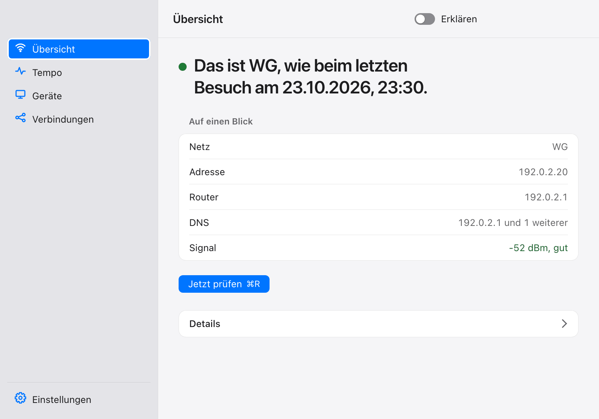
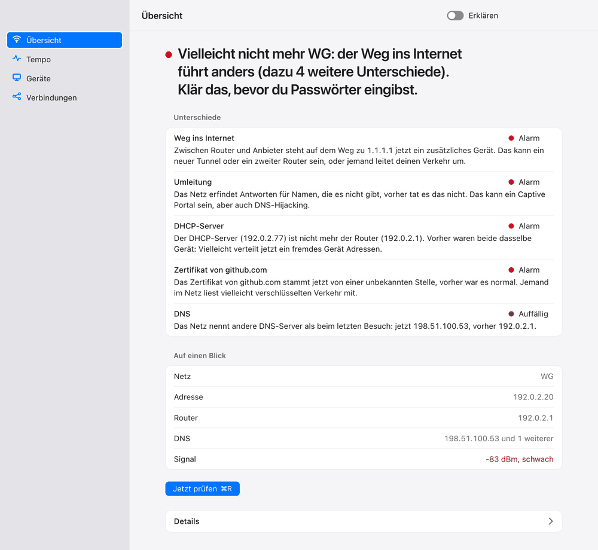
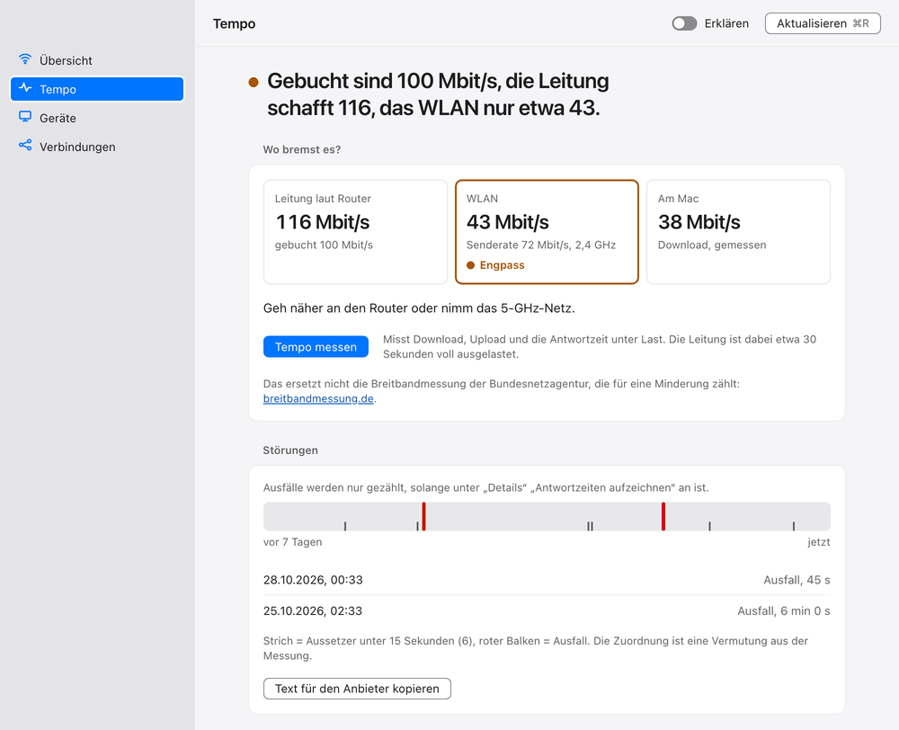
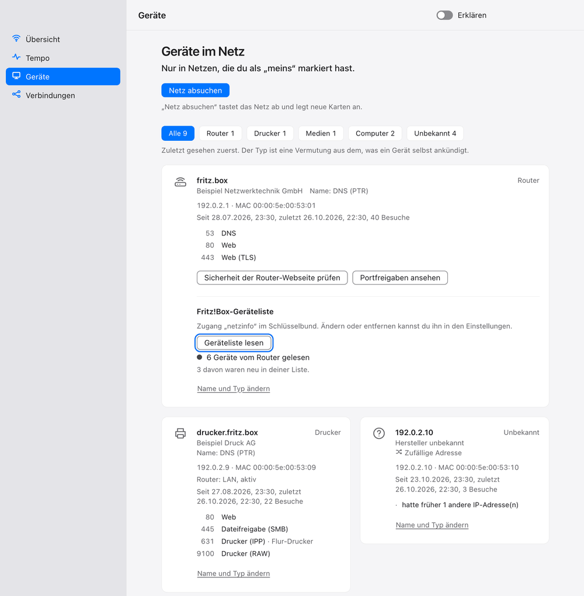
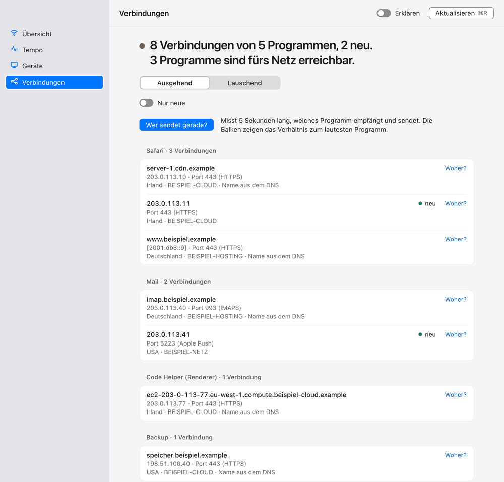

<p align="center">
  
</p>

<h1 align="center">Netzinfo</h1>

<p align="center">
  <b>Sagt dir, was in einem Netz anders ist als beim letzten Mal.</b><br>
  Mac-App und Kommandozeile, auf Deutsch, ohne Konto und ohne Telemetrie.
</p>

<p align="center">
  <a href="https://github.com/MiaLaMala/netzinfo/actions/workflows/ci.yml"></a>
  
  
  <a href="LICENSE"></a>
</p>

<p align="center">
  <b><a href="https://github.com/MiaLaMala/netzinfo/releases">Herunterladen</a></b> ·
  <a href="#installieren">Installieren</a> ·
  <a href="#was-netzinfo-kann">Was es kann</a> ·
  <a href="#kommandozeile">Kommandozeile</a> ·
  <a href="#datenschutz">Datenschutz</a> ·
  <a href="#english-in-short">English</a>
</p>

<p align="center">
  <picture>
    <source media="(prefers-color-scheme: dark)" srcset="docs/bilder/uebersicht-dunkel.png">
    
  </picture>
</p>

`ifconfig`, Wireshark und die Oberfläche der Fritz!Box zeigen ein Netz, wie es jetzt ist. Netzinfo merkt sich jedes Netz, in dem du warst (WG, Arbeit, Schule, Hotspot), und vergleicht beim nächsten Besuch: Ist das derselbe Router? Antwortet DNS wie immer? Hat das Zertifikat von github.com plötzlich jemand anderes unterschrieben? Ist ein Gerät dazugekommen?

Die Mac-App zeigt das in vier Ansichten, die Kommandozeile `netzinfo` läuft auch unter Linux. Mit „Erklären“ (App) oder `--erklaer` (Terminal) sagt jeder Schritt auf Deutsch, was gerade im Netz passiert, passend zum Stoff der IHK-Prüfung für Fachinformatiker.

## Was Netzinfo kann

Die App hat vier Ansichten. Jede beantwortet oben eine Frage, alles Weitere liegt eine Ebene tiefer unter „Details“. ⌘1 bis ⌘4 wechseln die Ansicht, ⌘R prüft neu, ⌘, öffnet die Einstellungen.

Drei Dinge sind der Kern:

- **Das Netz wiedererkennen und warnen.** Netzinfo vergleicht mit dem letzten Besuch: Router und DHCP, DNS-Antworten, Zertifikate (erkennt SSL-Inspection), öffentliche IP, Webfilter am Servernamen, Portfreigaben des Routers und der Weg ins Internet. Jede Abweichung ist harmlos, auffällig oder Alarm.
- **Den Engpass finden.** Die Leitung laut Router, das WLAN und der Mac stehen nebeneinander. Netzinfo sagt in einem Satz, welche der drei bremst, und was dagegen hilft. Fehlt eine Zahl, steht dort warum, geraten wird nicht.
- **Ein Störungsprotokoll für die Hotline.** Netzinfo hält fest, wann das Internet weg war und vermutet aus den Messungen, ob es am WLAN, am Router oder dahinter lag, und schreibt daraus einen sachlichen Text für den Anbieter. „Text für den Anbieter kopieren“ legt ihn in die Zwischenablage.

<table>
  <tr>
    <td width="50%"><picture><source media="(prefers-color-scheme: dark)" srcset="docs/bilder/uebersicht-alarm-dunkel.png"></picture><br><sub>Übersicht: Ist das noch mein Netz?</sub></td>
    <td width="50%"><picture><source media="(prefers-color-scheme: dark)" srcset="docs/bilder/tempo-dunkel.png"></picture><br><sub>Tempo: Bekomme ich, wofür ich zahle, und wo bremst es?</sub></td>
  </tr>
  <tr>
    <td width="50%"><picture><source media="(prefers-color-scheme: dark)" srcset="docs/bilder/geraete-dunkel.png"></picture><br><sub>Geräte: Wer ist noch in deinem Netz?</sub></td>
    <td width="50%"><picture><source media="(prefers-color-scheme: dark)" srcset="docs/bilder/verbindungen-dunkel.png"></picture><br><sub>Verbindungen: Wer redet mit wem, und wer lauscht?</sub></td>
  </tr>
</table>

### Übersicht

Oben steht in einem Satz, ob das Netz noch dasselbe ist wie beim letzten Besuch, darunter die fünf Werte Netz, Adresse, Router, DNS und Signal. Unter „Details“ liegen alle Einzelheiten: WLAN mit Signal und Sicherheit, Proxy, IPv6, verschlüsseltes DNS und jeder Punkt der Prüfung mit Zustand und Erklärung.

### Tempo

Oben die Engpass-Karte, darunter das Störungsprotokoll und die Live-Kurve mit Jitter und Verlust. Unter „Details“ liegen die Werkzeuge: Weg Hop für Hop, Paketgröße (MTU), Funkumfeld und Kanalwahl, DNS-Tempo, IPv4 gegen IPv6, die Uhrzeit, Antwortzeit unter Last und ausgehende Ports. „Wo hakt es?“ grenzt ein, ob es am Funk, am Router, am DNS oder am Internet liegt.

### Geräte

Findet Geräte im eigenen Netz, mit Hersteller und Namen aus Bonjour, UPnP und DNS, und merkt sich, wer neu dazugekommen ist. Beim Router schätzt Netzinfo die Router-Oberfläche ein, ohne sich anzumelden, und zeigt, welche Ports er per UPnP ins Internet geöffnet hat. Bei einer Fritz!Box liest es mit einem eigenen Zugang (nur auf dem Mac, einzutragen in den Einstellungen) auch deren Geräteliste, die Geräte kennt, die auf keinen Scan antworten. Gesucht wird nur in Netzen, die du als „meins“ markiert hast.

### Verbindungen

Jede aktive Verbindung je Programm mit Zielname, Land und Anbieter, wer gerade wie viel sendet und mit „Woher?“, wer ein Programm gestartet hat. Ein Umschalter zeigt statt der ausgehenden Verbindungen, welche Programme auf deinem Mac lauschen, ob nur für den Mac selbst oder fürs ganze Netz, und ob sie von Apple signiert sind.

### Einstellungen (⌘,)

Die Einstellungen stehen abgesetzt unter der Seitenleiste und haben drei Gruppen:

- **Gemerkte Netze:** alle Netze, die du dir gemerkt hast, zum Umbenennen, Vergessen und Markieren als „meins“. Nur ein Netz, das du als „meins“ markierst, darf Netzinfo nach Geräten und Ports absuchen.
- **Allgemein:** Netzinfo startet auf Wunsch mit der Anmeldung. Danach wacht es in der Menüleiste weiter, auch wenn das Fenster zu ist: Nach jedem Netzwechsel prüft es und schickt eine Mitteilung, wenn etwas auffällt.
- **Fritz!Box:** der Zugang für die Geräteliste. Das Passwort liegt nur im macOS-Schlüsselbund.

## Installieren

Unter [Releases](https://github.com/MiaLaMala/netzinfo/releases) liegen die App als `.dmg`, die Kommandozeile als `netzinfo-<tag>-aarch64-apple-darwin.tar.gz` und `SHA256SUMS` (`shasum -a 256 -c SHA256SUMS`). Nur Apple Silicon, macOS 13 oder neuer.

1. `.dmg` öffnen und Netzinfo in den Ordner „Programme“ ziehen.
2. Netzinfo starten. macOS meldet, dass es die App nicht prüfen konnte: Sie ist nur ad hoc signiert, nicht notarisiert.
3. „Fertig“ wählen, dann Systemeinstellungen, Datenschutz & Sicherheit, ganz nach unten, bei Netzinfo „Trotzdem öffnen“ und mit Passwort oder Touch ID bestätigen.
4. Beim ersten Scan fragt macOS nach „Lokales Netzwerk“. Erlauben, sonst findet Netzinfo keine Geräte.

Im Terminal gehen Schritt 2 und 3 auch so: `xattr -dr com.apple.quarantine /Applications/Netzinfo.app`, genauso für das entpackte `netzinfo`. Nach einem Update kann macOS „Lokales Netzwerk“ noch einmal abfragen, weil die Ad-hoc-Signatur bei jedem Build anders ist.

Unter Linux gibt es die Kommandozeile, nicht die App: `netzinfo-<tag>-x86_64-unknown-linux-musl.tar.gz` für PCs und Server, `netzinfo-<tag>-aarch64-unknown-linux-musl.tar.gz` für den Raspberry Pi mit 64-Bit-System. Beide sind statisch gebaut und laufen auf jeder Distribution. Entpacken und `./netzinfo hier` starten, der Ordner `ipdb` muss neben dem Programm liegen. Was unter Linux fehlt, steht bei [Wie es gebaut ist](#wie-es-gebaut-ist).

## Kommandozeile

`netzinfo --help` zeigt alle Befehle nach Thema, `netzinfo <Befehl> --help` nur die Zeilen eines Befehls, bei einem Tippfehler fragt Netzinfo nach („Meintest du `netzinfo pruefen`?“). Alle Befehle verstehen `--erklaer`. Exit-Code: 0 = geklappt, 1 = Fehler beim Ausführen, 2 = falscher Aufruf. Befehle, die es nur auf dem Mac gibt, sind in der Hilfe mit „(nur Mac)“ markiert. Die Ausgabe ist Text Zeile für Zeile, ohne Rahmen, Farbe oder Symbole, die etwas allein bedeuten, und bricht bei 100 Zeichen um, damit Screenreader und schmale Fenster sie gut lesen. `netzinfo live` zeichnet die Zeilen im Terminal neu und zeigt eine Blockkurve; mit `TERM=dumb` oder bei Umleitung in eine Datei gibt es stattdessen nur die Endzeilen als Text. `NO_COLOR` ist erfüllt, weil Netzinfo nie Farbe ausgibt. Was Netzinfo dabei sagt, ist Prüfungsstoff, hier am Beispiel Subnetting:

```console
$ netzinfo subnetz 192.0.2.77/26 --erklaer
Adresse:       192.0.2.77/26
Maske:         255.255.255.192 (11111111.11111111.11111111.11000000)
Netzadresse:   192.0.2.64
Broadcast:     192.0.2.127
Erster Host:   192.0.2.65
Letzter Host:  192.0.2.126
Anzahl Hosts:  62

  Erklärung: Rechenweg wie in der Prüfung:
  IP      11000000.00000000.00000010.01001101  192.0.2.77
  Maske   11111111.11111111.11111111.11000000  255.255.255.192
  UND     11000000.00000000.00000010.01000000  192.0.2.64
  Erklärung: UND-Verknüpfung: Ein Bit bleibt nur 1, wenn es in IP und Maske 1 ist. Das Ergebnis ist
             die Netzadresse.
  Host    00000000.00000000.00000000.00001101  0.0.0.13
  Erklärung: Hostanteil: die letzten 6 Bit der IP (IP UND invertierte Maske). Es bleibt der Teil,
             der das Gerät im Netz benennt.
  Erklärung: Broadcast: alle 6 Hostbits auf 1 setzen, hier 11000000.00000000.00000010.01111111.
  Erklärung: Hosts: 2^6 minus 2 (Netzadresse und Broadcast sind nicht vergebbar) = 62.
```

<details>
<summary><b>Dieses Netz</b></summary>

| Befehl | Was er macht |
|---|---|
| `netzinfo hier` | IP, Subnetz, Router und DNS, und ob du hier schon warst |
| `netzinfo subnetz <CIDR>` | Netz, Broadcast und Hostbereich ausrechnen |
| `netzinfo dns <Name> [--typ A\|AAAA\|MX\|TXT]` | Antwort deines Netzes gegen 1.1.1.1 und Quad9 |
| `netzinfo dns --meine-ip` | Öffentliche IP per DNS-Abfrage ermitteln |
| `netzinfo dns --verschluesselt` | Verschlüsseltes DNS (DoT, DoH) prüfen |
| `netzinfo tls [Host]` | Wer hat das Zertifikat unterschrieben? Erkennt SSL-Inspection |
| `netzinfo sni` | Filtert das Netz Seiten am Servernamen? |
| `netzinfo proxy` | Proxy, PAC und WPAD erkennen (nur Mac) |
| `netzinfo portal` | Hängt das Netz hinter einer Anmeldeseite? |
| `netzinfo wlan` | Funkverbindung, Signal und Sicherheit |
| `netzinfo ipv6 [Dienst]` | IPv4 und IPv6 im Vergleich, mit Happy Eyeballs |
| `netzinfo zeit` | Geht deine Uhr richtig? NTP und HTTPS-Date |
| `netzinfo router` | Router-Oberfläche passiv einschätzen: http, https, Zertifikat |
| `netzinfo portfreigaben` | Ports, die der Router per UPnP ins Internet geöffnet hat (nur lesen) |

</details>

<details open>
<summary><b>Merken und prüfen</b></summary>

| Befehl | Was er macht |
|---|---|
| `netzinfo merken <Name> [--meins]` | Aktuelles Netz merken, optional als „meins“ |
| `netzinfo netze` | Gemerkte Netze auflisten |
| `netzinfo vergessen <Name>` | Ein gemerktes Netz löschen |
| `netzinfo pruefen [--pfad]` | Was ist anders als beim letzten Besuch? |

</details>

<details>
<summary><b>Qualität</b></summary>

| Befehl | Was er macht |
|---|---|
| `netzinfo messen [--minuten N]` | Antwortzeiten und Aussetzer sammeln |
| `netzinfo bericht [Netz] [--markdown Datei]` | Median, Ausreißer, Verluste, auch als Datei für den IT-Support |
| `netzinfo diagnose` | Wo liegt das Problem? Schicht für Schicht |
| `netzinfo live <Ziel>… [--sekunden N]` | Ping-Kurve mit Jitter, Verlust und Eignung für Anrufe und Spiele |
| `netzinfo pfad [Ziel]` | Weg ins Internet Hop für Hop, ohne sudo |
| `netzinfo mtu [Ziel]` | Größte Paketgröße des Weges |
| `netzinfo dns --tempo` | Dein DNS gegen 1.1.1.1, 8.8.8.8 und 9.9.9.9 |
| `netzinfo wlan --verlauf` | Signal, Roaming und Abbrüche über Minuten |
| `netzinfo wlan --umfeld` | Netze je Kanal und Band, mit Rat für einen leereren Kanal (nur Mac) |
| `netzinfo last --start` | Antwortzeit unter Last (Bufferbloat), belastet die Leitung 30 s (nur Mac) |
| `netzinfo engpass [--start]` | Leitung laut Router, WLAN und Mac nebeneinander, mit dem Engpass in einem Satz |
| `netzinfo ports --raus --ziel <Server>` | Welche ausgehenden Ports lässt das Netz durch? |

</details>

<details>
<summary><b>Geräte im Netz</b></summary>

| Befehl | Was er macht |
|---|---|
| `netzinfo geraete [--nachbarn]` | Geräte im eigenen Netz, neu und verschwunden, mit MAC und Hersteller (`--nachbarn` nur Mac) |
| `netzinfo geraete --karten` | Gerätekarten mit Typ und Hinweisen |
| `netzinfo fritzbox [--zugang <Benutzer>\|--entfernen]` | Geräteliste der Fritz!Box über TR-064, Zugang im Schlüsselbund (nur Mac) |
| `netzinfo ports <Host>` | Offene Ports eines eigenen Geräts |
| `netzinfo bonjour [--txt]` | Dienste, die sich per Bonjour melden |
| `netzinfo upnp` | Geräte, die sich per UPnP vorstellen, mit Modell |

</details>

<details>
<summary><b>Dieser Mac</b> (unter Linux nicht verfügbar)</summary>

| Befehl | Was er macht |
|---|---|
| `netzinfo offen [--aussen]` | Welche Programme lauschen, und sind sie von außen erreichbar? |
| `netzinfo verbindungen` | Aktive Verbindungen je Programm mit Zielname |
| `netzinfo woher <Port&#124;Programm>` | Wer hat das Programm gestartet? Kette bis launchd |
| `netzinfo traffic [--sekunden N]` | Datenmenge je Programm, ohne Root |

</details>

Ausführlicher zu einzelnen Befehlen (Erkennung eines Netzes, Einstufung in `pruefen`, Hersteller-Liste, IPv6-Router, Testserver für `ports --raus`): [docs/befehle.md](docs/befehle.md).

## Datenschutz

- Netzinfo hat keinen eigenen Server, kein Konto und keine Telemetrie. Was es sich merkt (Merkmale jedes Netzes, Messwerte, Gerätelisten), liegt nur auf deinem Mac in `~/Library/Application Support/netzinfo/` (anderer Ort: Umgebungsvariable `NETZ_DATEN`).
- Der Zugang zur Fritz!Box (Benutzer und Passwort) liegt nur im macOS-Schlüsselbund, nie in einer Datei und nie als Argument eines anderen Programms. Netzinfo liest damit nur die Geräteliste und ändert nichts.
- Gescannt wird nur, was dir gehört: `ports`, `geraete` und `portfreigaben` laufen nur gegen private Adressen und nur in Netzen, die du als „meins“ markiert hast. Auf dem eigenen Rechner geht es immer. In fremden Netzen macht Netzinfo nur, was jeder Laptop beim Verbinden ohnehin tut.
- Ins Internet gehen nur Prüfanfragen, keine Daten von dir:
  - DNS-Fragen an öffentliche Resolver (1.1.1.1, 8.8.8.8, 9.9.9.9) zum Vergleich und für die eigene öffentliche IP (Cloudflare antwortet mit der Adresse, von der die Frage kam). `dns --tempo` fragt dabei rund 20 bekannte Seitennamen, dazu die, die du selbst angibst.
  - Verschlüsseltes DNS bei Cloudflare und Quad9 (`dns --verschluesselt`).
  - TLS-Verbindungsaufbau mit github.com, apple.com und cloudflare.com, für den SNI-Test auch mit bbc.com, youtube.com und telegram.org.
  - IPv4 gegen IPv6 mit cloudflare.com, google.com, wikipedia.org, dns.quad9.net und www.apple.com.
  - Die Portal-Prüfadressen von Apple, Google und Firefox.
  - Die Uhrzeit von time.apple.com und pool.ntp.org und der Date-Kopf von www.cloudflare.com.
  - Pings und der Weg zu 1.1.1.1 und 9.9.9.9.
  - Mit `--erklaer` sagt jeder Befehl, was er wohin schickt.
- Der Lasttest (`last`, geht zu Apples Testservern und kann mehrere hundert Megabyte verbrauchen) und der Test ausgehender Ports (`ports --raus`, nur gegen deinen eigenen Server) laufen nur auf ausdrücklichen Start.
- Vom Weg ins Internet speichert Netzinfo nur gekürzte Hop-Adressen (/24 und /48).
- Land und Anbieter eines Ziels schlägt Netzinfo in einer Datei nach, die mit der App kommt. Dafür geht keine Adresse ins Netz.

Sicherheitslücken bitte nicht als Issue melden, sondern wie in [SECURITY.md](SECURITY.md) beschrieben.

## Selbst bauen

Du brauchst Rust (stable) und die Xcode Command Line Tools, sonst nichts. Die Oberfläche ist schlichtes HTML, CSS und JavaScript ohne npm.

```sh
cargo build --release                 # Kommandozeile
./target/release/netzinfo hier --erklaer

cargo build -p netzinfo-app           # Mac-App
./target/debug/netzinfo-app
```

Land und Anbieter in `verbindungen` brauchen zwei Offline-Datenbanken (zusammen etwa 18 MB, nicht im Git): `sh tools/ipdb-bauen.sh ipdb` lädt sie mit fester Version und Prüfsumme. Ohne sie bleiben die beiden Felder leer.

`app/vorschau.html` zeigt die ganze Oberfläche mit erfundenen Daten in jedem Browser, ohne die App zu starten. Daraus stammen auch die Bilder oben.

## Wie es gebaut ist

```
src/            Kern als Bibliothek und Kommandozeile, Rust
app/src/        Mac-App mit Tauri 2, Menüleisten-Wache
app/ui/         Oberfläche: HTML, CSS und JavaScript ohne npm und ohne Framework
app/vorschau/   Beispieldaten für app/vorschau.html
data/           Herstellerliste aus dem IEEE-Register
ipdb/           Offline-Datenbanken für Land und Anbieter (nicht im Git)
tools/          Skripte, die diese Datenbanken bauen
testdata/       Aufgezeichnete Antworten für die Tests
```

- Rund 28 000 Zeilen Rust in gut 50 Dateien, über 400 Tests. Parser und Bewertungsregeln werden mit aufgezeichneten Ausgaben echter Werkzeuge getestet, Netzwerkcode gegen lokale Testserver.
- Wenige Abhängigkeiten: rustls und ring für TLS, socket2 für Ping und Traceroute ohne Root, serde für die gespeicherten Daten, maxminddb für die Offline-Datenbanken. DNS, Bonjour, SSDP und UPnP spricht Netzinfo selbst.
- Die CI prüft jeden Pull Request unter Linux und auf dem Mac mit `cargo fmt`, `cargo clippy -D warnings`, den Tests und `cargo deny` (Lizenzen, bekannte Lücken). Ein Tag baut die App als `.dmg` und die Kommandozeile als Archiv mit Prüfsummen.
- Der Kern baut auch unter Linux, die CI läuft dort. Was nur auf macOS geht (CoreWLAN, libproc), hat unter Linux eine eigene Variante oder einen klaren Fehlersatz.
- Unter Linux liest Netzinfo Default-Route, Adresse und DHCP ohne Root (`/proc/net/route`, `getifaddrs`, systemd-networkd oder NetworkManager), danach laufen `hier`, `dns`, `pruefen`, `merken`, `messen`, `diagnose`, `mtu`, `pfad`, `bonjour`, `upnp`, `router` und `wlan` (mit `iw`). `geraete` läuft ohne `--nachbarn`.
- Nur auf dem Mac gehen `offen`, `verbindungen`, `woher`, `traffic`, `last`, `wlan --umfeld`, `geraete --nachbarn`, `proxy`, `fritzbox` (Schlüsselbund) und die Standortfreigabe, weil sie libproc, CoreWLAN, `nettop`, `networkQuality` oder `scutil` brauchen. Sie melden das mit einem klaren Satz. Die Linux-Fassung ist bisher nur in der CI und im Release-Probelauf gelaufen, nicht von Hand auf einem Server oder Raspberry Pi.
- Die Strichbilder der leeren Zustände sind mit Higgsfield (Recraft V4.1) erzeugt, als ein einziges Bild, damit der Strich überall gleich ist. Danach sind sie von Hand zerlegt und bekommen ihre Farben aus dem CSS, damit sie im Dunkelmodus passen.

Wie man mitmacht, steht in [CONTRIBUTING.md](CONTRIBUTING.md).

## English in short

Netzinfo remembers every network your Mac has been on and tells you when one behaves differently than last time: a new router, changed DNS answers, TLS interception, new devices. `ifconfig` or Wireshark show a network as it is right now; Netzinfo compares it with your last visit. It comes as a Mac app (Tauri, Apple Silicon, macOS 13+) and as a command line tool `netzinfo` for macOS and Linux (x86_64 and arm64), built on the same Rust core. **The interface, the output and the docs are in German**; `--erklaer` (or the “Erklären” switch in the app) explains in plain German what each step does on the wire. Downloads are on the [Releases page](https://github.com/MiaLaMala/netzinfo/releases); the app is only ad-hoc signed, see “Installieren”. Scanning only targets private addresses on networks you marked as yours. No telemetry, no account, MIT licensed.

## Lizenz

MIT, siehe [LICENSE](LICENSE). Herstellerliste aus dem IEEE-Register, Länder aus DB-IP Lite (IP Geolocation by [DB-IP](https://db-ip.com), CC BY 4.0), Anbieter aus IPtoASN (PDDL 1.0), siehe [THIRD_PARTY.md](THIRD_PARTY.md).
